<p align="right"><sub><a href="README.md">简体中文</a> · <b>English</b></sub></p>

<picture>
  <source media="(prefers-color-scheme: dark)" srcset="assets/readme/hero-dark.svg">
  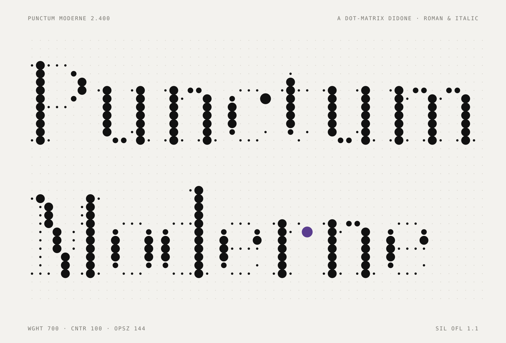
</picture>

<h3 align="center">A Didone on the dot matrix. Stems are full dots, hairlines are pinpricks.</h3>

<p align="center"><i>Roman and italic, three axes, one grid.</i></p>

<p align="center">
  <a href="https://sundyme.github.io/punctum-moderne/?lang=en"><b>Website</b></a>
  &nbsp;&nbsp;·&nbsp;&nbsp;
  <a href="#install--use">Install</a>
  &nbsp;&nbsp;·&nbsp;&nbsp;
  <a href="https://sundyme.github.io/punctum-moderne/italic.html?lang=en">Italic</a>
  &nbsp;&nbsp;·&nbsp;&nbsp;
  <a href="https://sundyme.github.io/punctum-moderne/?lang=en#films">Films</a>
  &nbsp;&nbsp;·&nbsp;&nbsp;
  <a href="OFL.txt">SIL OFL 1.1</a>
</p>

<br>

<picture>
  <source media="(prefers-color-scheme: dark)" srcset="assets/readme/specs-dark.svg">
  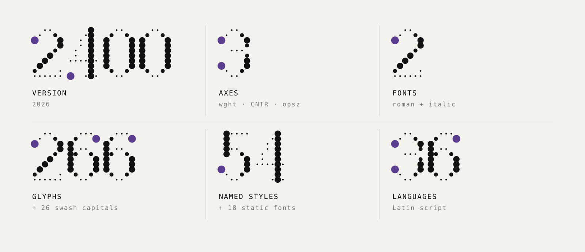
</picture>

<br>

## 01　The idea

The Didone was born at the end of the eighteenth century as that era’s “modern” face. Pressing a broad-nib pen down leaves a full stem; lifting it leaves a hairline. Dot-matrix letters belong to machines: every dot the same size, set on a grid, like a pin printer or a station departure board.

**Punctum Moderne puts the two on one grid.** The dots do not imitate strokes; each one remembers a measure of pressure. A thick dot is the pen pressing down, a hairline dot is the pen lifting, a transition dot is the pen relaxing, and a ball is the drop left where the stroke stops.

<picture>
  <source media="(prefers-color-scheme: dark)" srcset="assets/readme/idea-dark.jpg">
  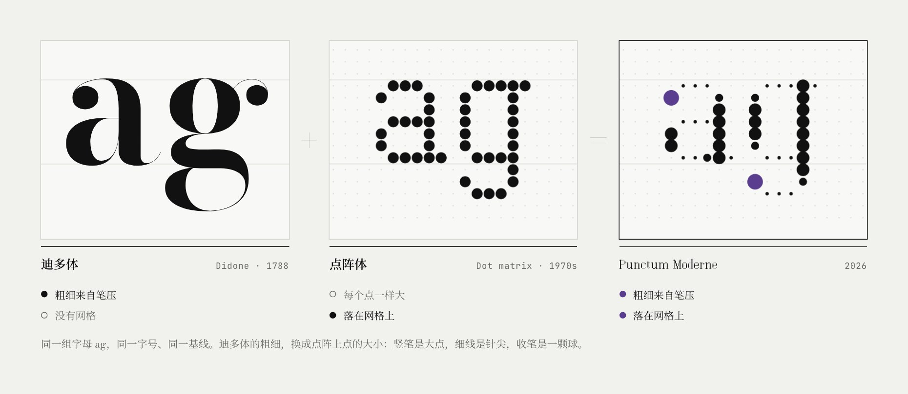
</picture>

<sub>The same letters ag, at one size, on one baseline. The Didone’s thick and thin become the size of the dots.</sub>

Chinese Song type grew from the same thread: heavy verticals, light horizontals, and a mark where each horizontal ends. In Song type the mark is a triangular “beak”; in the Didone it is an upright hairline serif; in Punctum it is a single dot folded upward.

<picture>
  <source media="(prefers-color-scheme: dark)" srcset="assets/readme/song-dark.jpg">
  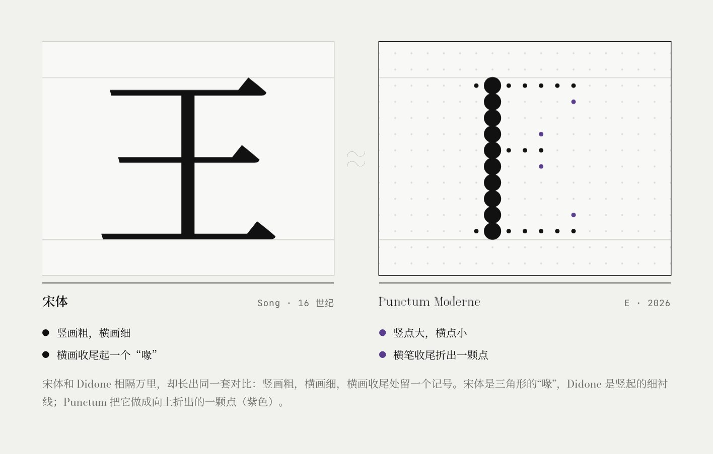
</picture>

<br>

## 02　Four tones per dot

The dots of an ordinary matrix display are either on or off. Every dot in Punctum Moderne is marked with one of four tones, the four states of a broad-nib pen on paper. Letters and accents are drawn dot by dot, and the position and tone of more than five thousand dots are written in the source; accented letters are composed from those hand-drawn letters and accents.

<picture>
  <source media="(prefers-color-scheme: dark)" srcset="assets/readme/tones-dark.svg">
  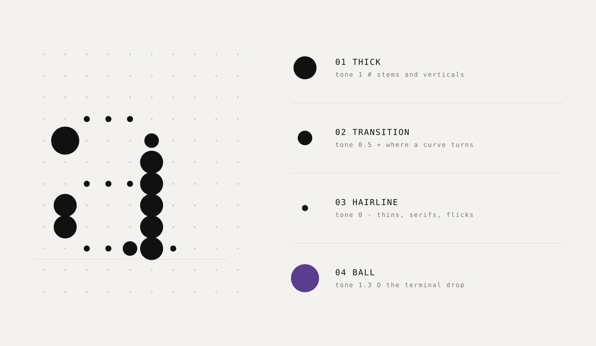
</picture>

<br>

## 03　Three axes, one file

The variable axes never move a dot; they only change its radius. Anywhere in the design space, the structure of every letter is exactly the same.

<picture>
  <source media="(prefers-color-scheme: dark)" srcset="assets/readme/axes-dark.svg">
  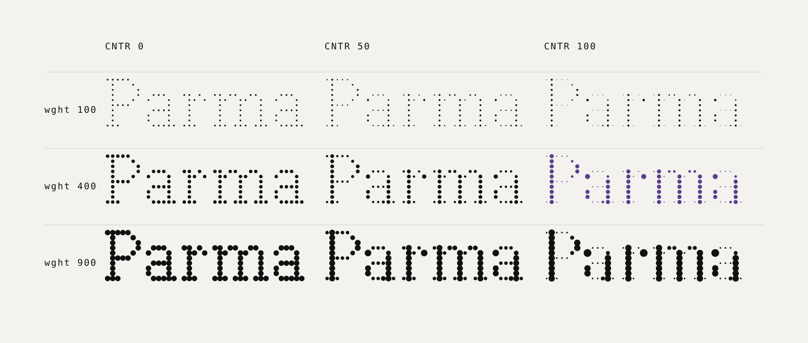
</picture>

| Axis | Tag | Range | What it does |
| :-- | :-- | :-- | :-- |
| Weight | `wght` | 100 – 900 | The size of the thick dots |
| Contrast | `CNTR` | 0 – 100 | 0 is a slab matrix with every dot the same size; 100 is full Didone pressure |
| Optical size | `opsz` | 12 – 144 | The smaller the type, the fuller the hairline dots; follows the font size automatically |

<picture>
  <source media="(prefers-color-scheme: dark)" srcset="assets/readme/opsz-dark.svg">
  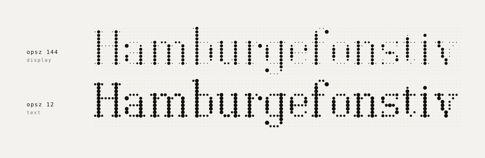
</picture>

<sub>Lines from afar, dots up close: at small sizes the eye merges neighbouring dots into a continuous stroke, the same principle as halftone printing.</sub>

<br>

## 04　One grid

One dot pitch is 1/16 em. Every advance width is a whole number of pitches; at a line height of 1, a line is exactly 16 pitches, with the cap height at 10 rows and the x-height at 7. Kerning moves only in whole dots too: the algorithm finds how far the right letter can move left before any dots come too close, then takes two-thirds of that gap. So To and AV tighten, and the grid never breaks. The roman has 6,323 kerning pairs, the italic 6,127, plus pairs reserved for the swash capitals.

<picture>
  <source media="(prefers-color-scheme: dark)" srcset="assets/readme/grid-dark.svg">
  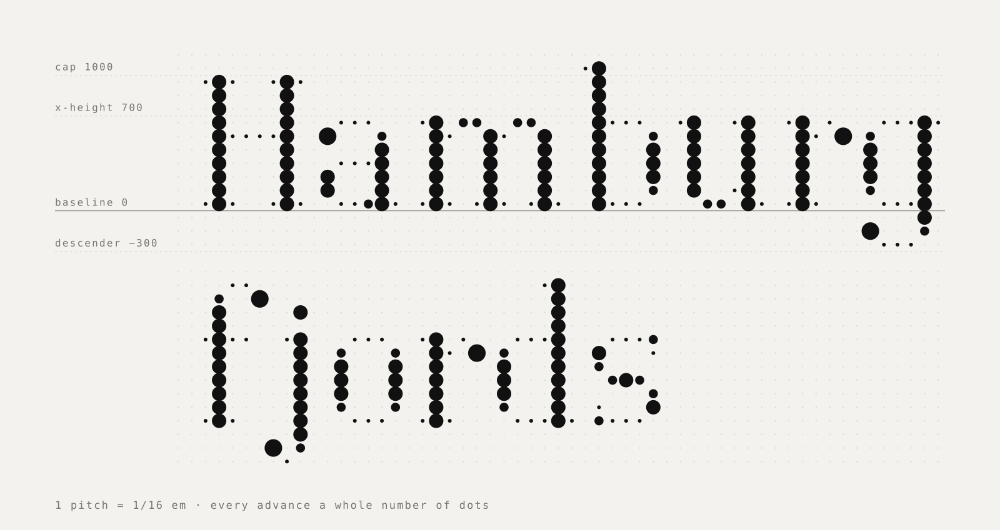
</picture>

<picture>
  <source media="(prefers-color-scheme: dark)" srcset="assets/readme/kern-dark.svg">
  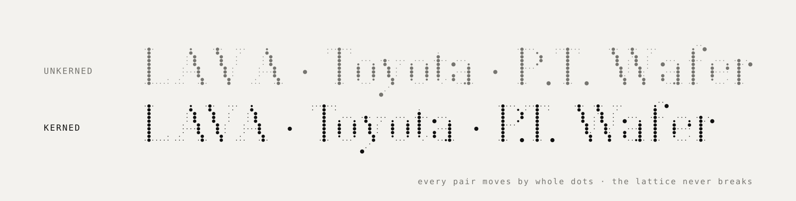
</picture>

<br>

## 05　Italic and swash capitals

The italic is more than a slanted roman. The whole lattice is sheared 12°: with each row up, the dots step right by tan 12° ≈ 0.21 of a pitch. Sixteen lowercase letters are also redrawn as a cursive, each stem finishing in a hairline that flicks up and to the right toward the next letter. Twenty-six swash capitals start and finish on an ink ball, and are switched on in the italic with `swsh` or `ss01`.

<picture>
  <source media="(prefers-color-scheme: dark)" srcset="assets/readme/italic-dark.svg">
  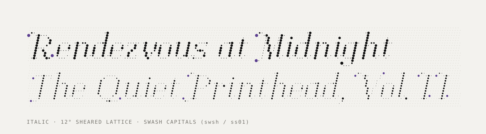
</picture>

```css
em      { font-style: italic; }                      /* a true italic, not a synthesized one */
.swash  { font-feature-settings: "swsh" 1; }         /* swash capitals, italic only */
```

<br>

## 06　Character set

Basic Latin plus most of Latin-1 and Latin Extended-A: 266 characters covering 36 languages written in the Latin alphabet. Capital accents get a row of their own instead of sitting on the letter. Every glyph also comes in italic: the whole lattice is sheared 12°, and sixteen lowercase letters are redrawn as a cursive.

<picture>
  <source media="(prefers-color-scheme: dark)" srcset="assets/readme/charset-dark.svg">
  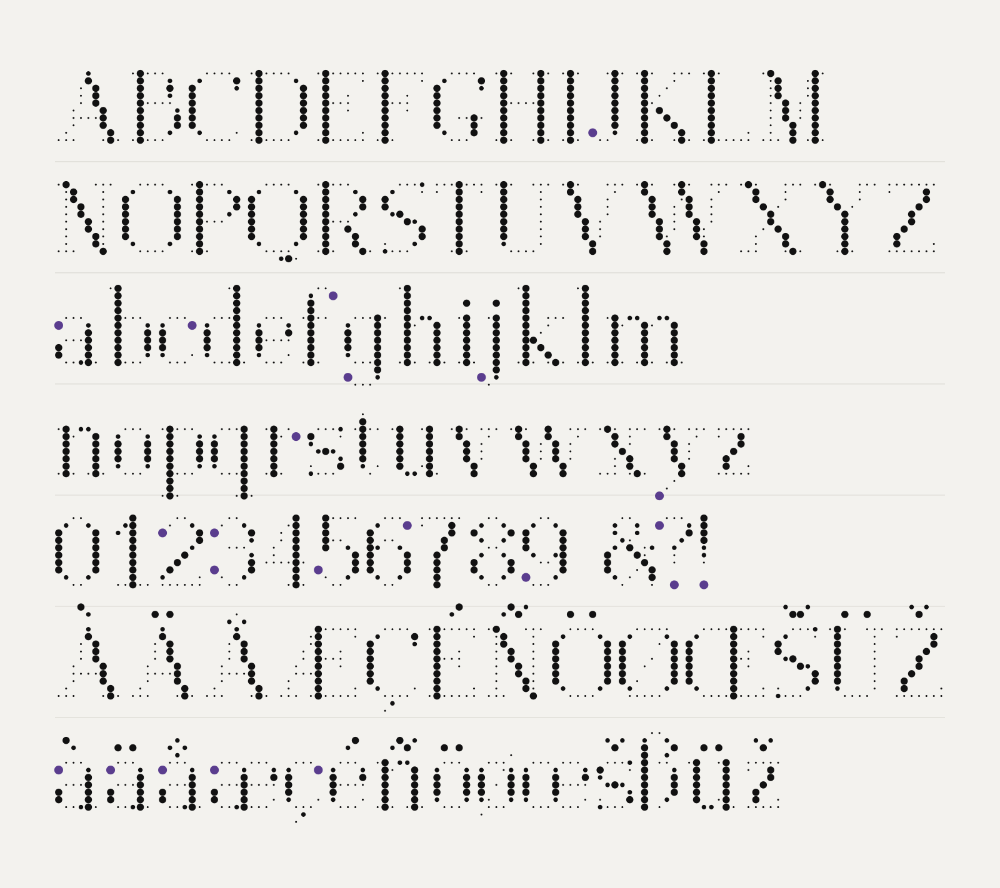
</picture>

<sub>Violet marks the balls: the drop left where the stroke stops.</sub>

<br>

## 07　From a drop of ink to a point of light <sub>Five lives of a dot · 1788 – 2026</sub>

Ink drop, music box, punch card, inkjet, light: the dot is one of humanity’s oldest marks and today’s smallest unit of display. All five demos on the website take your own word, with glyphs and dot sizes read straight from the font data.

<a href="https://sundyme.github.io/punctum-moderne/?lang=en#idea">
<picture>
  <source media="(prefers-color-scheme: dark)" srcset="assets/readme/carousel-dark.jpg">
  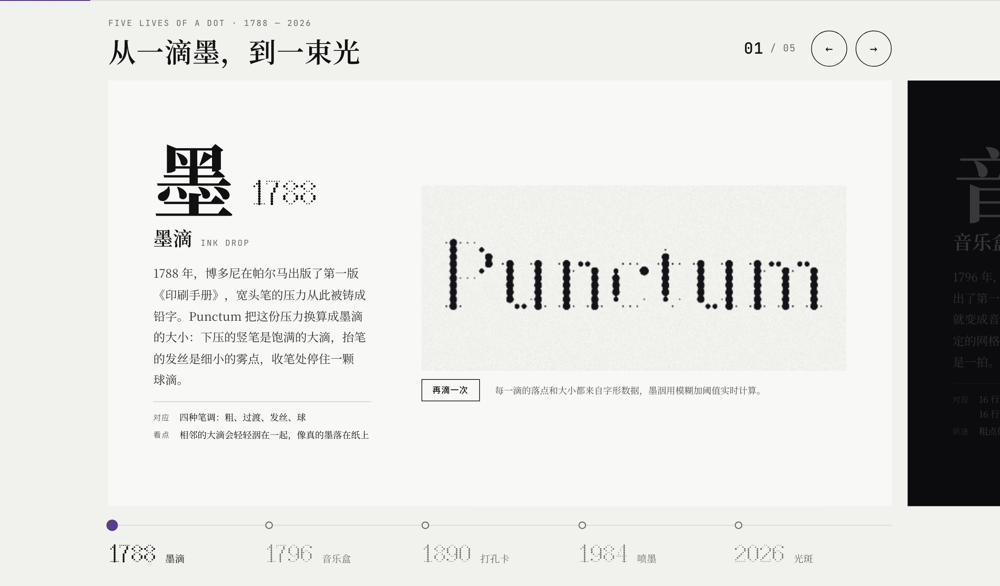
</picture>
</a>

<br>

## 08　In use

An exhibition poster, book and magazine covers, perfume packaging, a menu, wayfinding, business cards and a watch face: ten specimen boards, all set live on the web page with the same font.

<picture>
  <source media="(prefers-color-scheme: dark)" srcset="assets/readme/gallery-1-dark.jpg">
  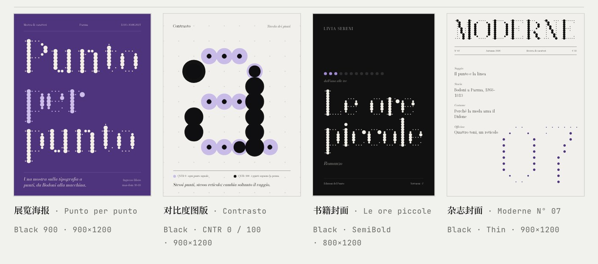
</picture>

<picture>
  <source media="(prefers-color-scheme: dark)" srcset="assets/readme/gallery-3-dark.jpg">
  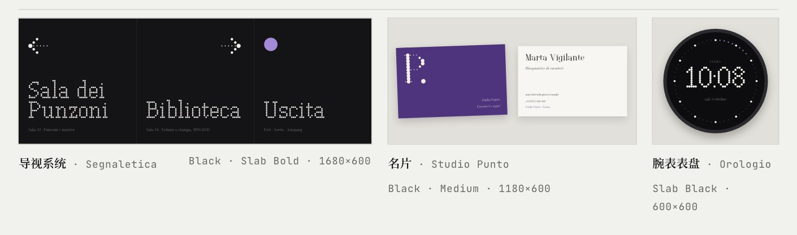
</picture>

<br>

## 09　Films

One dot, told three ways. Every frame is generated from the font’s dot data, and each score is synthesized note by note from the events on screen.

<table>
  <tr>
    <td width="33%" valign="top">
      <a href="https://sundyme.github.io/punctum-moderne/?lang=en#films">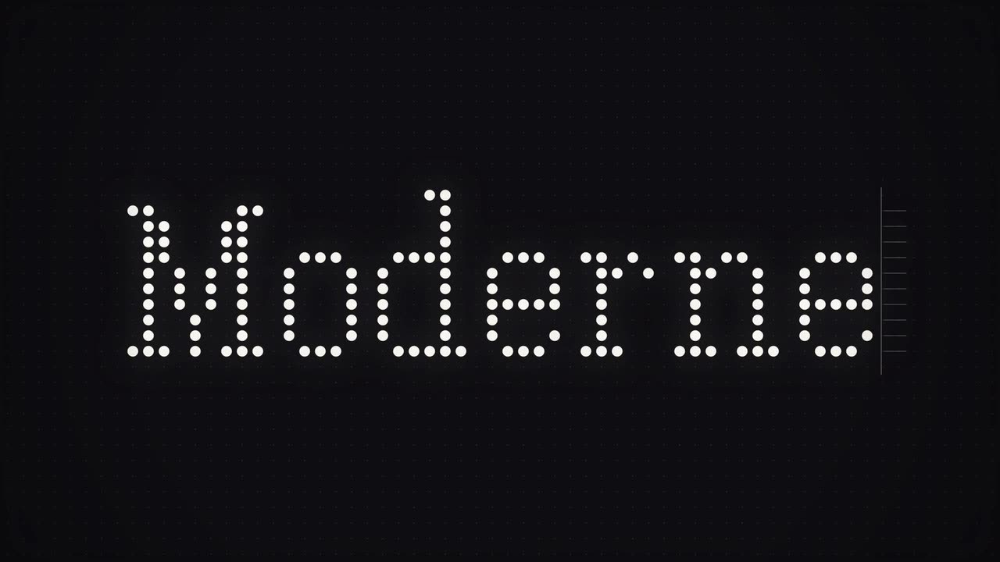</a>
      <sub>01 · One take · 1:00</sub><br>
      <b>The Life of a Dot</b><br>
      <sub>A dot breathes, is written into an a by the pen, struck into Moderne by the pins and plucked on a music comb; the camera pulls back until the whole text turns out to be one ball in the wordmark.</sub>
    </td>
    <td width="33%" valign="top">
      <a href="https://sundyme.github.io/punctum-moderne/?lang=en#films">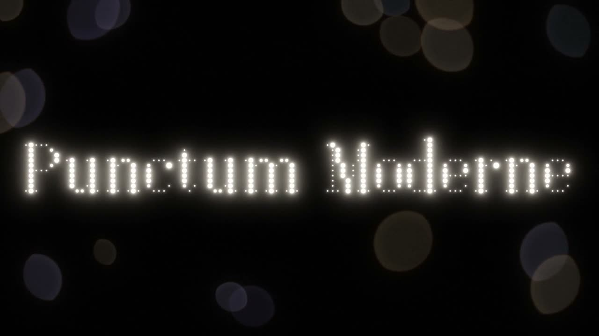</a>
      <sub>02 · Macro · 3D render · 0:48</sub><br>
      <b>Five Materials</b><br>
      <sub>A black void, one softbox, one macro lens. The same dot travels in date order through ink, a music box, a punch card, inkjet and light.</sub>
    </td>
    <td width="33%" valign="top">
      <a href="https://sundyme.github.io/punctum-moderne/?lang=en#films">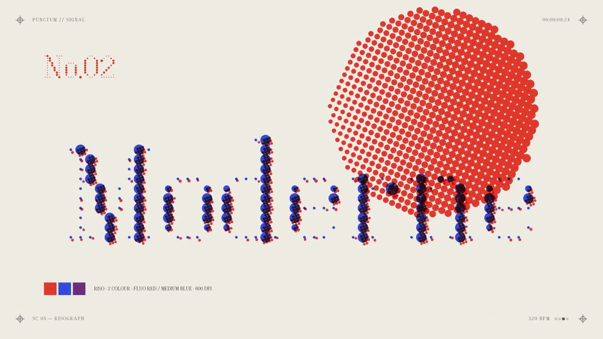</a>
      <sub>03 · Fast cuts · 120 BPM · 0:30</sub><br>
      <b>Signal</b><br>
      <sub>Morse code, marquee bulbs, risograph, split-flap, pin printer and CRT: six kinds of dot that send a signal, cut on the beat.</sub>
    </td>
  </tr>
</table>

A 72-second **release film** and a 32-second vertical social cut followed, rendered frame by frame with a hand-written WebGL2 dot engine, with two scores (synthesized in numpy, and an ElevenLabs edit). Sources are in [films/release](films/release); 1080p masters of all the films are attached to [Releases · films-2026-10](https://github.com/sundyme/punctum-moderne/releases/tag/films-2026-10).

<br>

## Install & use

**[Download PunctumModerne.zip](https://github.com/sundyme/punctum-moderne/releases/latest/download/PunctumModerne.zip)** · variable fonts, 18 statics, web fonts and sample CSS, about 1 MB · [Release notes](https://github.com/sundyme/punctum-moderne/releases/latest)

| File | Use |
| :-- | :-- |
| [`fonts/PunctumModerne[CNTR,opsz,wght].ttf`](fonts) | Roman variable font · desktop |
| [`fonts/PunctumModerne-Italic[CNTR,opsz,wght].ttf`](fonts) | Italic variable font · with swash capitals |
| [`fonts/PunctumModerne-VF.woff2`](fonts) · [`-Italic-VF.woff2`](fonts) | Web · 77 KB / 135 KB |
| [`fonts/static/`](fonts/static) | 18 static styles: Thin · Light · Regular · Bold · Black · Slab · Text, each with Italic |

- **macOS**: double-click both variable fonts and install them in Font Book. Design apps will show 54 named styles.
- **Windows**: right-click the font files and choose “Install for all users”. For apps without variable font support, install the static styles in `fonts/static/` instead.
- **Web**: load both woff2 files; the browser sets the optical size from the font size.

```css
@font-face {
  font-family: "Punctum Moderne";
  src: url("PunctumModerne-VF.woff2") format("woff2");
  font-weight: 100 900;
  font-style: normal;
}
@font-face {
  font-family: "Punctum Moderne";
  src: url("PunctumModerne-Italic-VF.woff2") format("woff2");
  font-weight: 100 900;
  font-style: italic;
}
h1 {
  font-family: "Punctum Moderne", serif;
  font-variation-settings: "wght" 900, "CNTR" 100;   /* never hard-code opsz */
  line-height: 1;                                    /* the grid runs on from line to line */
}
```

<details>
<summary><b>Recommended settings</b></summary>

| Setting | Recommended | Why |
| :-- | :-- | :-- |
| Optical size | `font-optical-sizing: auto` | The browser default. Hard-coding opsz takes the fuller hairlines away from small sizes |
| Font size | ≥ 14px | From 14 to 32px the Text optical size takes over and reads as a medium-contrast serif |
| Line height | `1`, or `1.125` `1.25` `1.5` | Each line is exactly 16 pitches, so the dots of every line sit on one grid |
| Letter spacing | `0` or `n × 0.0625em` | Whole-dot steps never break the grid |
| Weight at small sizes | `wght` 400–600 | The Text style already strengthens stems and hairlines |
| Pixel alignment | Multiples of 16px | The dot pitch lands on whole pixels for the sharpest screen rendering |

</details>

<br>

## Build from source

The glyphs are written as ASCII dot grids in [`src/glyphs.py`](src/glyphs.py): `#` thick, `+` transition, `-` hairline, `O` ball. The radius model is in [`src/radii.py`](src/radii.py) and the kerning algorithm in [`src/kern.py`](src/kern.py).

```bash
pip install fonttools brotli numpy

python3 src/build.py        # two variable fonts, two woff2, 18 statics  →  fonts/
python3 site/build.py       # website  →  docs/index.html
python3 italic/build.py     # italic release page  →  docs/italic.html
python3 inuse/make.py       # ten specimen boards  →  inuse/project/
python3 tools/readme_art.py # the dot illustrations in this README  →  assets/readme/
```

The films are [HyperFrames](https://www.npmjs.com/package/hyperframes) projects; each folder previews and renders on its own:

```bash
cd films/five-materials
node tools/export-events.cjs && python3 tools/score.py   # synthesize the score from on-screen events
npx hyperframes preview                                  # preview
npx hyperframes render --fps 60 --quality delivery       # render 1080p60
```

<br>

## Prior art

Building letters from dots is an old idea. Punctum Moderne is neither the first dot-matrix typeface nor the first in which dot size follows stroke weight. Below are the relatives we know of, and how we differ from them.

| Typeface | Designer / year | In common | How Punctum differs |
| --- | --- | --- | --- |
| [Doto](https://fonts.google.com/specimen/Doto) | Óliver Lalan · 2024 · OFL | Variable dot matrix; `wght` sets dot size, `ROND` moves dots between round and square | The closest relative of `v1/`. v1 uses a 5×9 grid (capitals on 5×7), Doto a 6×10 one. Our glyphs were drawn by hand and the font files are generated by this repository's scripts; no Doto files were used |
| [Punto](https://fonts.adobe.com/fonts/punto) | Arne Freytag · Fontador | Dot size follows stroke weight | Moderne puts that idea on a Didone skeleton: four tones per dot, a `CNTR` axis from slab dot matrix to Didone, an `opsz` axis, plus an italic and swash capitals |
| [Linotype Punkt](https://www.myfonts.com/fonts/linotype/punkt) | Mischa Leiner · Linotype | Letters made of evenly spaced dots | Our dots are not all the same size; each carries the weight of its stroke |
| [Powerhouse Punctum](https://matterofsorts.com/) | Vincent Chan · 2023 · custom for the Powerhouse Museum | Same name; also inspired by punch cards and dot-matrix printers | The two projects are unrelated. To avoid confusion, this project always goes by its full name, **Punctum Moderne** |

A 5×7 grid leaves little room, so many v1 capitals inevitably resemble decades of LCD and printer character sets. That is the shared vocabulary of the grid.

<br>

## Repository

```text
fonts/                 variable fonts, woff2 and 18 static fonts
src/                   glyph grids, tone radius model, kerning, build scripts
site/                  website source  →  docs/
italic/                italic release page source  →  docs/italic.html
inuse/                 ten specimen boards
films/
  life-of-a-dot/       The Life of a Dot · 60s · canvas dot engine
  life-of-a-dot-loop/  15-second seamless loop
  five-materials/      Five Materials · 48s · WebGL2
  signal/              Signal · 30s · retro dot media
  release/             Release film 72s + 9:16 social cut 32s · hand-written WebGL2 dot engine
cjk/                   CJK extension proposal "Punctum Song": proposal page, dot converter prototype, size test
docs/                  GitHub Pages: website, italic page, 720p films
tools/                 README illustration generator
v1/                    Punctum v1: a 5×7 matrix with ROND and wght axes
```

<br>

## License

The fonts and font sources (`fonts/`, `src/`, `v1/`) are released under the [SIL Open Font License 1.1](OFL.txt): free to use, embed, modify and redistribute, but the fonts may not be sold on their own. The code for the website, films and tools is released under the [MIT License](LICENSE).

<br>

<p align="center">
  <sub>Punctum Moderne 2.400 · Designed by Claude for <a href="https://github.com/sundyme">sundyme</a> · Website text in Bodoni Moda and Noto Serif SC · Labels in JetBrains Mono</sub>
</p>
