<picture>
  <source media="(prefers-color-scheme: dark)" srcset="assets/readme/hero-dark.svg">
  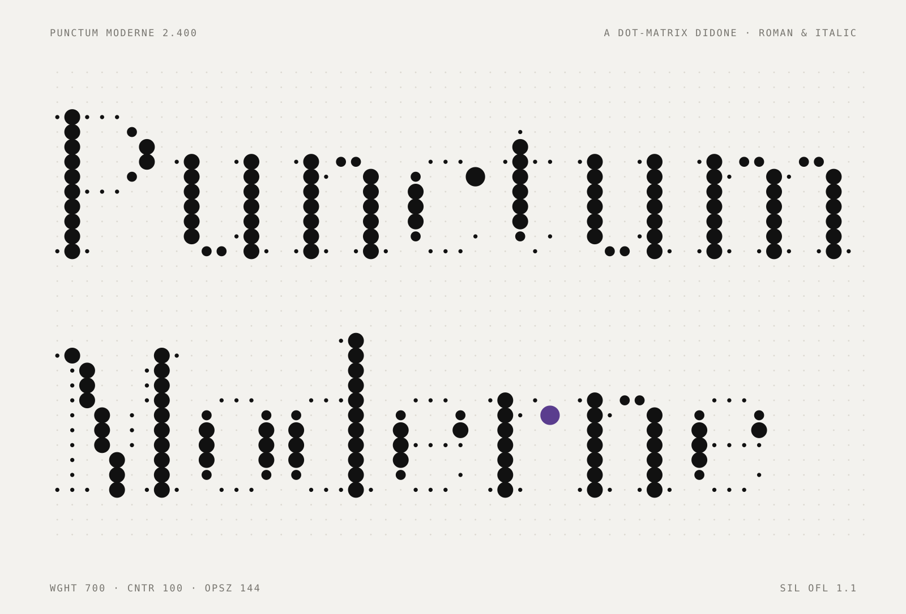
</picture>

<h3 align="center">点阵上的 Didone。竖笔是大点，横笔是针尖。</h3>

<p align="center"><i>A dot-matrix Didone, roman and italic, in three axes and one grid.</i></p>

<p align="center">
  <a href="https://sundyme.github.io/punctum-moderne/"><b>网站 Website</b></a>
  &nbsp;&nbsp;·&nbsp;&nbsp;
  <a href="#安装与使用-install--use">下载 Install</a>
  &nbsp;&nbsp;·&nbsp;&nbsp;
  <a href="https://sundyme.github.io/punctum-moderne/italic.html">斜体 Italic</a>
  &nbsp;&nbsp;·&nbsp;&nbsp;
  <a href="https://sundyme.github.io/punctum-moderne/#films">短片 Films</a>
  &nbsp;&nbsp;·&nbsp;&nbsp;
  <a href="OFL.txt">SIL OFL 1.1</a>
</p>

<br>

<table align="center">
  <tr>
    <td align="center"><sub>版本 VERSION</sub><br><b>2.400</b></td>
    <td align="center"><sub>字体 FONTS</sub><br><b>正体 · 斜体</b></td>
    <td align="center"><sub>可变轴 AXES</sub><br><b>wght · CNTR · opsz</b></td>
    <td align="center"><sub>字符 GLYPHS</sub><br><b>266 + 26</b></td>
    <td align="center"><sub>命名样式 STYLES</sub><br><b>54</b></td>
    <td align="center"><sub>字偶 KERNING</sub><br><b>6,323 · 13,670</b></td>
    <td align="center"><sub>语言 LANGUAGES</sub><br><b>36</b></td>
  </tr>
</table>

<br>

## 01　理念 <sub>The idea</sub>

迪多体诞生于十八世纪末，是当时的“现代体”：宽头笔下压留下饱满的竖笔，抬起留下发丝般的细线。点阵字属于机器，每个点一样大，落在网格上，像针式打印机和车站的显示屏。

**Punctum Moderne 把两者放进同一张网格。** 点不去模仿笔画，而是每个点记住一份笔压：粗点是下压，发丝点是抬起，过渡点是笔在放松，球点是收笔时停住的那一滴。

<picture>
  <source media="(prefers-color-scheme: dark)" srcset="assets/readme/idea-dark.jpg">
  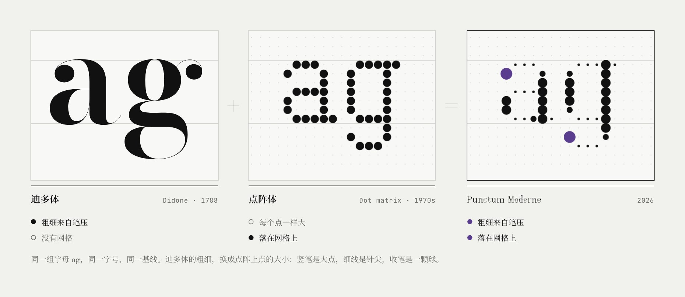
</picture>

<sub>同一组字母 ag，同一字号，同一基线。迪多体的粗细，换成点阵上点的大小。</sub>

宋体沿着同一条线索长出来：竖画粗，横画细，横画收尾处留一个记号。宋体是三角形的“喙”，Didone 是竖起的细衬线，Punctum 把它做成向上折出的一颗点。

<picture>
  <source media="(prefers-color-scheme: dark)" srcset="assets/readme/song-dark.jpg">
  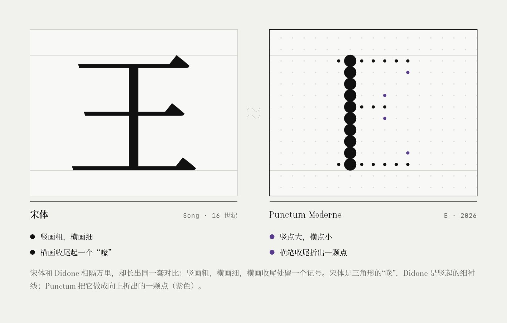
</picture>

<br>

## 02　四种笔调 <sub>Four tones per dot</sub>

普通点阵屏的点只有亮和灭。Punctum Moderne 的每个点都标注了四种笔调之一，对应一支宽头笔在纸上的四种状态。全部 266 个字符、上万个点，没有一个是算法放的，都是手工标注。

<picture>
  <source media="(prefers-color-scheme: dark)" srcset="assets/readme/tones-dark.svg">
  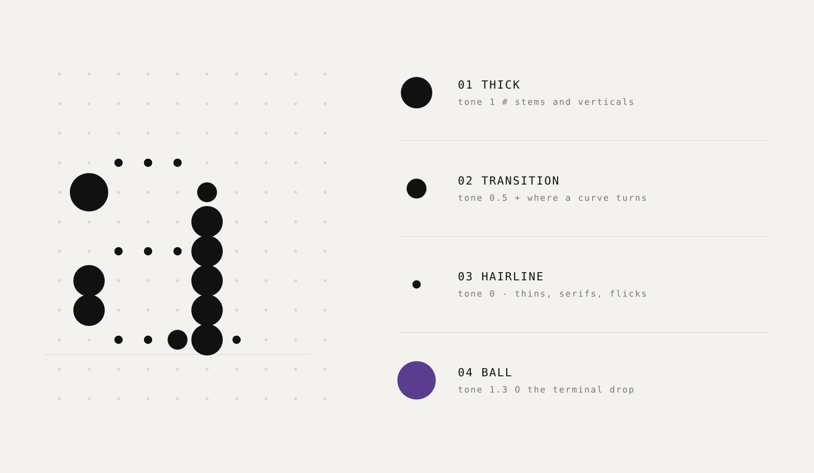
</picture>

<br>

## 03　三条轴 <sub>Three axes, one file</sub>

可变轴不会移动任何一个点，只改变点的半径。所以设计空间里任何位置的字形结构都完全一致。

<picture>
  <source media="(prefers-color-scheme: dark)" srcset="assets/readme/axes-dark.svg">
  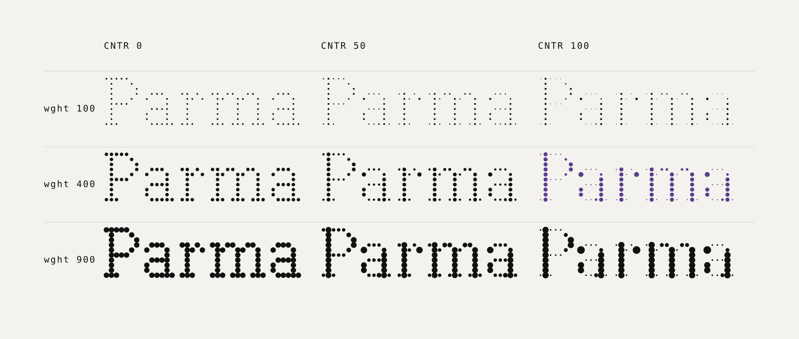
</picture>

| 轴 Axis | 标签 Tag | 范围 Range | 作用 What it does |
| :-- | :-- | :-- | :-- |
| 字重 Weight | `wght` | 100 – 900 | 粗点的大小 · *the size of the thick dots* |
| 对比度 Contrast | `CNTR` | 0 – 100 | 0 是每个点等大的平衬线点阵，100 是完整的 Didone 笔压 · *slab to Didone* |
| 光学尺寸 Optical size | `opsz` | 12 – 144 | 字越小，发丝点越饱满，跟随字号自动调整 · *hairlines fatten as the type gets smaller* |

<picture>
  <source media="(prefers-color-scheme: dark)" srcset="assets/readme/opsz-dark.svg">
  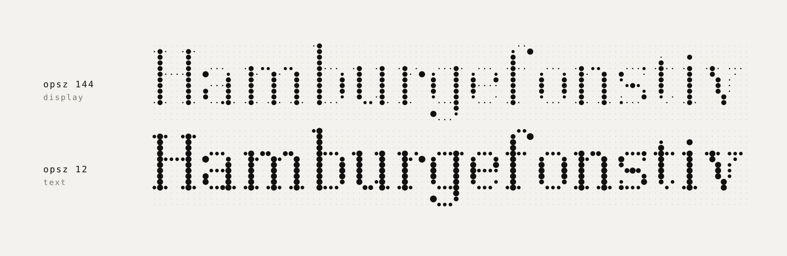
</picture>

<sub>远看是线，近看是点：小字号下，眼睛把相邻的点融成连续的笔画，这和网点印刷是同一个原理。</sub>

<br>

## 04　一张网格 <sub>One grid</sub>

一个点距是 1/16 em。每个字宽都是整数个点距，行高 1 时一行正好 16 个点距，大写高 10 行，x 高 7 行。字偶距调整也只按整点移动：算法找出右边的字能左移多远而不让任何点靠得太近，再取这段空隙的三分之二。所以 To、AV 会收紧，网格却不会断。

<picture>
  <source media="(prefers-color-scheme: dark)" srcset="assets/readme/grid-dark.svg">
  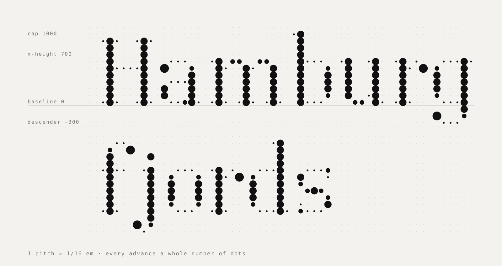
</picture>

<picture>
  <source media="(prefers-color-scheme: dark)" srcset="assets/readme/kern-dark.svg">
  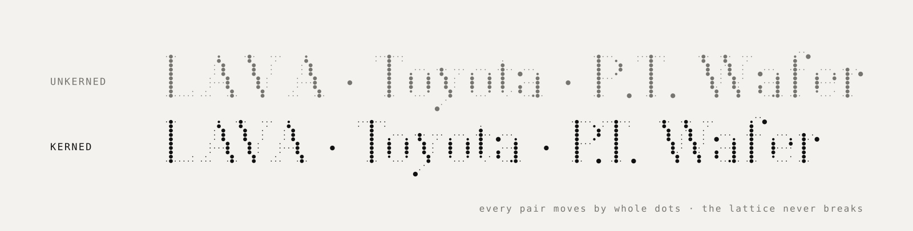
</picture>

<br>

## 05　斜体与花式大写 <sub>Italic and swash capitals</sub>

斜体不是把正体推斜：整张点阵按 12° 剪切，每往上一行，点向右错开 tan 12° ≈ 0.21 个点距。16 个小写按书写体重画，竖画收尾时用一根细线向右上挑出，引向下一个字母。26 个花式大写以墨球起笔、以墨球收笔，在斜体中通过 `swsh` 或 `ss01` 开启。

<picture>
  <source media="(prefers-color-scheme: dark)" srcset="assets/readme/italic-dark.svg">
  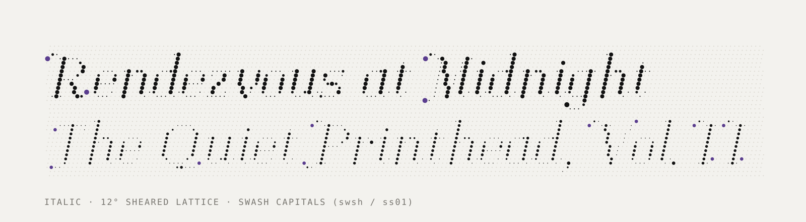
</picture>

```css
em      { font-style: italic; }                      /* 真斜体，不是合成的 */
.swash  { font-feature-settings: "swsh" 1; }         /* 花式大写，仅斜体 */
```

<br>

## 06　字符集 <sub>Character set</sub>

基本拉丁、Latin-1 与 Latin Extended-A：266 个字符，覆盖 36 种使用拉丁字母的语言。大写的变音符号另留了一行空白，不贴在字母顶部。每一个字形在斜体里都重新画过一遍。

<picture>
  <source media="(prefers-color-scheme: dark)" srcset="assets/readme/charset-dark.svg">
  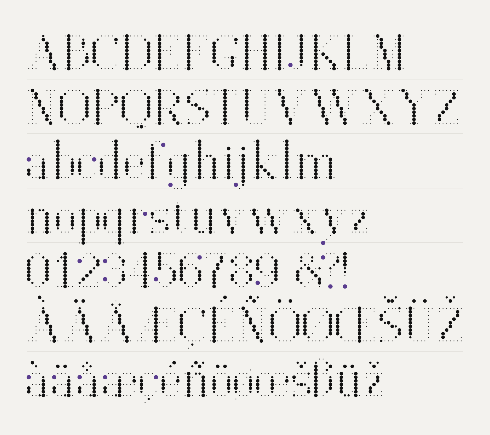
</picture>

<sub>紫色是球点：收笔时停住的那一滴。</sub>

<br>

## 07　从一滴墨，到一束光 <sub>Five lives of a dot · 1788 – 2026</sub>

墨滴、音乐盒、打孔卡、喷墨、光斑：点是人类最早的记号之一，也是今天最小的显示单位。网站上的五个演示都可以输入自己的词，字形与点的大小直接取自字体数据。

<a href="https://sundyme.github.io/punctum-moderne/#idea">
<picture>
  <source media="(prefers-color-scheme: dark)" srcset="assets/readme/carousel-dark.jpg">
  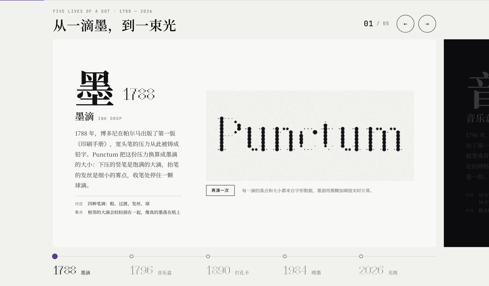
</picture>
</a>

<br>

## 08　样例 <sub>In use</sub>

展览海报、书籍封面、杂志、香水包装、菜单、导视、名片与腕表表盘，十块样例画板都用网页里的同一个字体实时排版。

<picture>
  <source media="(prefers-color-scheme: dark)" srcset="assets/readme/gallery-1-dark.jpg">
  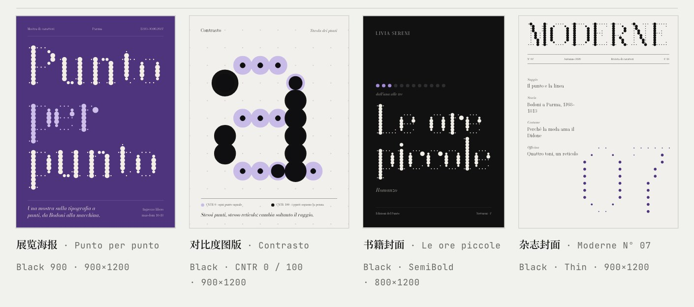
</picture>

<picture>
  <source media="(prefers-color-scheme: dark)" srcset="assets/readme/gallery-3-dark.jpg">
  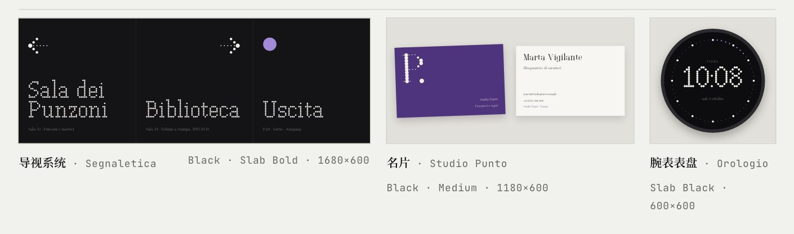
</picture>

<br>

## 09　影像 <sub>Films</sub>

一个点，三种讲法。画面全部由字体的点阵数据生成，配乐按画面里的事件逐音合成。

<table>
  <tr>
    <td width="33%" valign="top">
      <a href="https://sundyme.github.io/punctum-moderne/#films">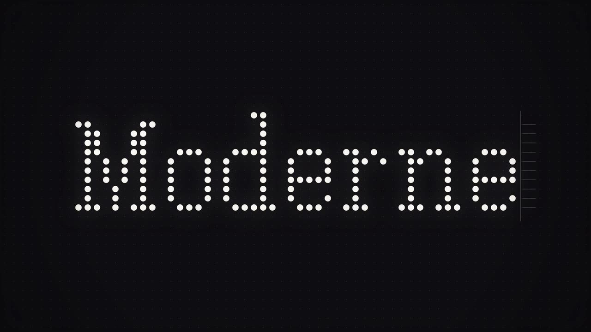</a>
      <sub>01 · 一镜到底 · 1:00</sub><br>
      <b>一个点的一生</b> <i>The Life of a Dot</i><br>
      <sub>一个点先呼吸，再被笔写成 a，被针头打成 Moderne，被音梳拨响；镜头一路拉远，整段文字原来只是字标里的一颗球点。</sub>
    </td>
    <td width="33%" valign="top">
      <a href="https://sundyme.github.io/punctum-moderne/#films">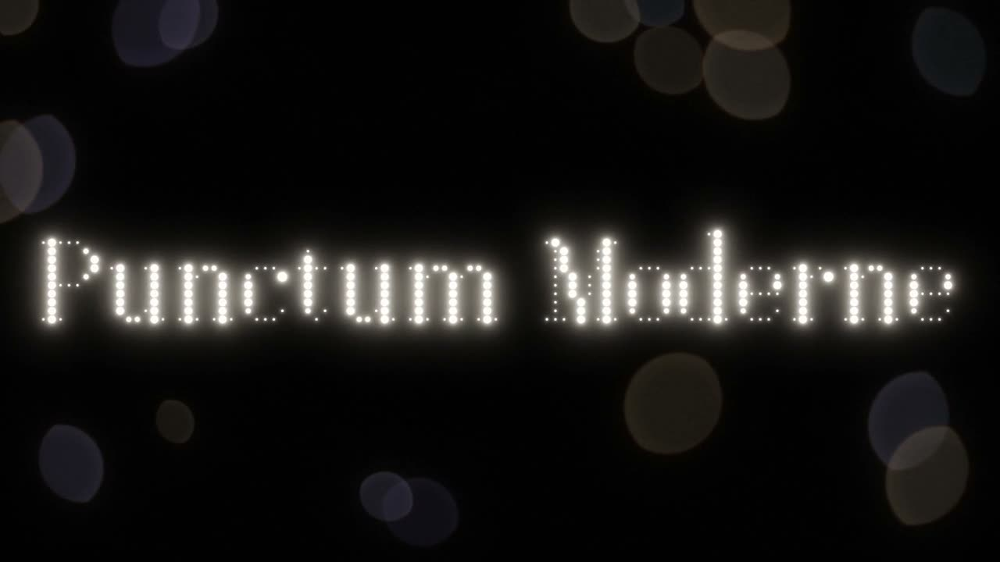</a>
      <sub>02 · 微距 · 三维渲染 · 0:48</sub><br>
      <b>五种介质</b> <i>Five Materials</i><br>
      <sub>黑色空间、一盏柔光箱、一支微距镜头。同一个点按年代穿过墨滴、音乐盒、打孔卡、喷墨与光斑。</sub>
    </td>
    <td width="33%" valign="top">
      <a href="https://sundyme.github.io/punctum-moderne/#films">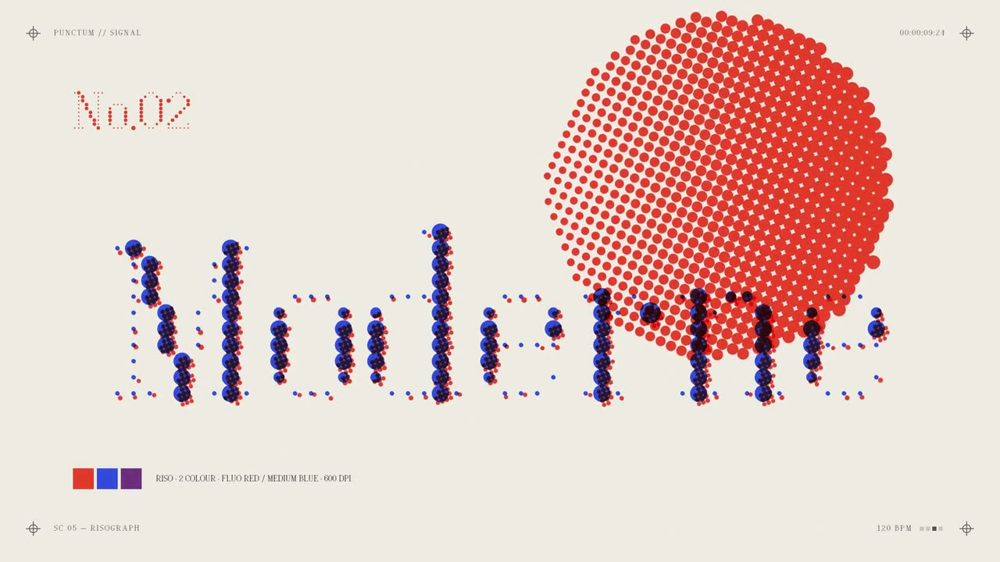</a>
      <sub>03 · 快切 · 120 BPM · 0:30</sub><br>
      <b>信号</b> <i>Signal</i><br>
      <sub>摩尔斯电码、剧场灯泡、孔版套印、翻牌、针式打印、显像管：六种会发信号的点，踩着鼓点切换。</sub>
    </td>
  </tr>
</table>

<br>

## 安装与使用 <sub>Install & use</sub>

| 文件 File | 用途 Use |
| :-- | :-- |
| [`fonts/PunctumModerne[CNTR,opsz,wght].ttf`](fonts) | 正体可变字体 · 桌面安装 |
| [`fonts/PunctumModerne-Italic[CNTR,opsz,wght].ttf`](fonts) | 斜体可变字体 · 含花式大写 |
| [`fonts/PunctumModerne-VF.woff2`](fonts) · [`-Italic-VF.woff2`](fonts) | 网页用 · 76 KB / 135 KB |
| [`fonts/static/`](fonts/static) | 18 个静态样式：Thin · Light · Regular · Bold · Black · Slab · Text，各含 Italic |

- **macOS**：双击两个可变字体，在“字体册”中安装。设计软件里会出现 54 个命名样式。
- **Windows**：右键字体文件，选择“为所有用户安装”。不支持可变字体的软件，请改装 `fonts/static/` 里的静态样式。
- **网页**：引入两个 woff2，光学尺寸会由浏览器按字号自动设置。

```css
@font-face {
  font-family: "Punctum Moderne";
  src: url("PunctumModerne-VF.woff2") format("woff2");
  font-weight: 100 900;
  font-style: normal;
}
@font-face {
  font-family: "Punctum Moderne";
  src: url("PunctumModerne-Italic-VF.woff2") format("woff2");
  font-weight: 100 900;
  font-style: italic;
}
h1 {
  font-family: "Punctum Moderne", serif;
  font-variation-settings: "wght" 900, "CNTR" 100;   /* 不要写死 opsz */
  line-height: 1;                                    /* 行与行之间网格连续 */
}
```

<details>
<summary><b>推荐设置</b> <sub>Recommended settings</sub></summary>

| 设置 | 推荐值 | 原因 |
| :-- | :-- | :-- |
| 光学尺寸 | `font-optical-sizing: auto` | 浏览器默认值。写死 opsz 会让小字号失去加粗的细线 |
| 字号 | ≥ 14px | 14–32px 由 Text 光学尺寸接管，读起来是一款中等对比的衬线体 |
| 行高 | `1` 或 `1.125` `1.25` `1.5` | 每行正好 16 个点距，上下行的点落在同一张网格上 |
| 字距 | `0` 或 `n × 0.0625em` | 按整点增减不会打断网格 |
| 小字号字重 | `wght` 400–600 | Text 样式已经加粗了竖笔和细线 |
| 字号像素对齐 | 16px 的倍数 | 点距落在整像素上，屏幕渲染最锐利 |

</details>

<br>

## 从源文件构建 <sub>Build from source</sub>

字形以 ASCII 点阵写在 [`src/glyphs.py`](src/glyphs.py) 里：`#` 粗，`+` 过渡，`-` 细，`O` 球。半径模型在 [`src/radii.py`](src/radii.py)，字偶算法在 [`src/kern.py`](src/kern.py)。

```bash
pip install fonttools brotli numpy

python3 src/build.py        # 两个可变字体、两个 woff2、18 个静态字体  →  fonts/
python3 site/build.py       # 网站  →  docs/index.html
python3 italic/build.py     # 斜体发布页  →  docs/italic.html
python3 inuse/make.py       # 十块样例画板  →  inuse/project/
python3 tools/readme_art.py # 本页的点阵插图  →  assets/readme/
```

短片是 [HyperFrames](https://www.npmjs.com/package/hyperframes) 项目，每个目录都能独立预览与渲染：

```bash
cd films/five-materials
node tools/export-events.cjs && python3 tools/score.py   # 由画面事件合成配乐
npx hyperframes preview                                  # 预览
npx hyperframes render --fps 60 --quality delivery       # 渲染 1080p60
```

<br>

## 仓库结构 <sub>Repository</sub>

```text
fonts/                 可变字体、woff2 与 18 个静态字体
src/                   字形点阵、笔调半径模型、字偶算法、构建脚本
site/                  网站源文件  →  docs/
italic/                斜体发布页源文件  →  docs/italic.html
inuse/                 十块样例画板
films/
  life-of-a-dot/       《一个点的一生》 60s · canvas 点阵引擎
  life-of-a-dot-loop/  15 秒无缝循环片段
  five-materials/      《五种介质》 48s · WebGL2 渲染
  signal/              《信号》 30s · 复古点阵媒介
docs/                  GitHub Pages：网站、斜体页、720p 短片
tools/                 README 插图生成器
v1/                    Punctum 第一版：5×7 点阵，ROND 与 wght 两条轴
```

<br>

## 授权 <sub>License</sub>

字体与字体源文件（`fonts/`、`src/`、`v1/`）以 [SIL Open Font License 1.1](OFL.txt) 发布：可以免费使用、嵌入、修改和再发布，但不能单独出售字体文件。网站、短片与工具的代码以 [MIT](LICENSE) 发布。

<br>

<p align="center">
  <sub>Punctum Moderne 2.400 · 设计 Claude，为 <a href="https://github.com/sundyme">sundyme</a> · 正文 Bodoni Moda 与 Noto Serif SC · 标注 JetBrains Mono</sub>
</p>
